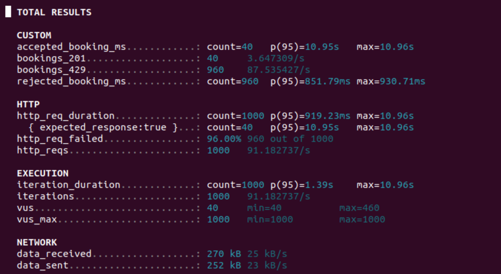

# Event Booking

## Objective

This project demonstrates how the **bulkhead pattern** limits concurrent work
and isolates resources to reduce resource exhaustion during booking surges or
payment gateway slowdowns. It also uses a circuit breaker to pause payment
processing when the gateway is unhealthy and resume it as the gateway recovers.

The two Spring Boot services communicate only through Kafka:

- **Booking Service** accepts bookings, holds them as pending, publishes payment
  requests, and updates or expires bookings based on payment results and hold time.
- **Payment Service** processes payment requests through a mock gateway, publishes
  results, handles simulated refunds, and provides payment status queries.

The services run locally; Kafka, separate PostgreSQL databases, and the mock
gateway run with Docker Compose.

## Run

From the project root:

```sh
docker compose -f infra/docker-compose.yml up -d
mvn -pl booking-service spring-boot:run
mvn -pl payment-service spring-boot:run
```

The booking API listens on `http://localhost:8081` and the payment query API on
`http://localhost:8082`. 

Create a booking:

```sh
curl -i http://localhost:8081/bookings \
  -H 'Content-Type: application/json' \
  -d '{"eventId":"11111111-1111-1111-1111-111111111111","userId":"22222222-2222-2222-2222-222222222222","seats":2,"amount":40.00}'
```

Actuator endpoints are exposed by
both services under `/actuator`; WireMock's admin API is available on port 8089.

To simulate a slow gateway for the manual verification scenarios below, update
the seeded WireMock mapping and restore it to 200ms afterward:

```sh
curl -X PUT http://localhost:8089/__admin/mappings/41fc0ed5-2712-4c72-96a1-7710a0d81f18 \
  -H 'Content-Type: application/json' \
  -d '{"request":{"method":"POST","urlPath":"/charge"},"response":{"status":200,"fixedDelayMilliseconds":8000,"headers":{"Content-Type":"application/json"},"jsonBody":{"approved":true,"transactionId":"mock-transaction"}}}'
```

Set `fixedDelayMilliseconds` back to `200` to restore the baseline gateway.
The verification steps below provide a reusable command for changing the delay.


## Bulkhead verification

**Use case:** A surge in bookings or slow gateway calls can consume all threads
or connections. Bulkheads limit concurrent work and isolate resources so that
other operations still have capacity. The configured semaphore limits are 40 concurrent
booking creations and 5 concurrent gateway calls, with no waiting for a permit.

### Booking surge (V4)

1. Restart the booking service with configurable delay to simulate time consuming booking operation. If set < 1sec, booking operation finishes fast and bulkhead count value might always look like 40 (max value).  Run without the environment variable to
   disable it.

   ```sh
   BOOKING_SIMULATED_CREATE_DELAY=5s mvn -pl booking-service spring-boot:run
   ```

   In separate terminal, continuously poll the booking bulkhead available-permit metric:

   ```sh
   watch -n 0.2 'curl -s "http://localhost:8081/actuator/metrics/resilience4j.bulkhead.available.concurrent.calls?tag=name:createBooking" | jq'
   ```

2. In a separate terminal, launch 1,000 simultaneous one-request virtual users. K6 must be installed locally before running it.


   ```sh
   bash booking-service/scripts/booking-surge.sh
   ```

3. Completion of the script, gives the result as shown in the image. Evidence of the bulkhead is **HTTP 429** for excess requests, with permits
   never below zero and returning to 40 after the load. 
   

### Clean up Test data

The cleanup script targets **every** booking with event ID
`11111111-1111-1111-1111-111111111111`. It deletes their corresponding
payment rows first, then the booking rows.

1. Stop the booking and payment applications and finish any load-generating
   requests. Ensure no other producers or consumers are using this Kafka
   instance.
2. Keep the two PostgreSQL services running and execute:

   ```sh
   bash booking-service/scripts/booking-cleanup.sh --allow-retained-kafka
   ```

   It displays the booking count, and asks for `DELETE` confirmation. This opt-in waits until the sum of reported numeric consumer lag is zero, then
asks for confirmation. It does not check for missing consumer groups, unknown
lag, or DLT records; verify those separately if needed. 
