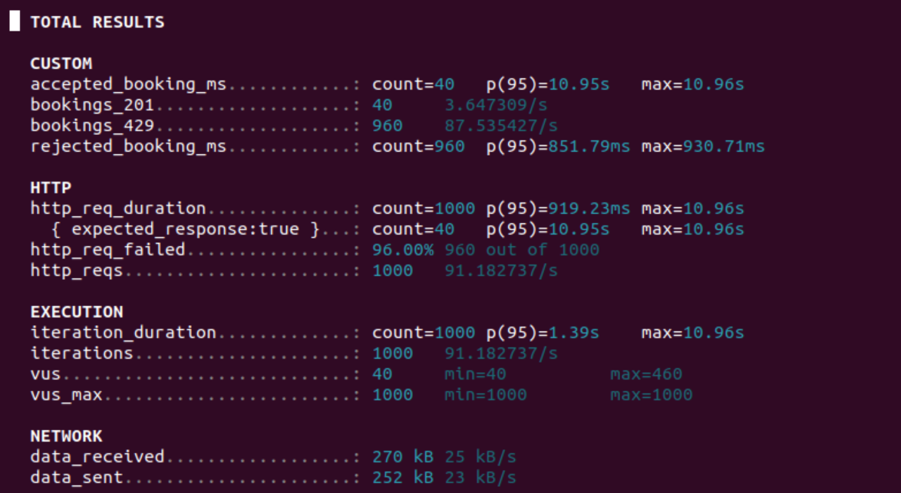

# V4: Booking surge

**Prerequisites:** Independent of V2 and V3. Start with a healthy gateway and
the services running. k6, curl, jq and watch are required for the commands
below.

**What it tests:** How booking-service handles a sudden spike in
`POST /bookings`. The `createBooking` bulkhead limits concurrent creation work
and sheds excess load instead of letting every request enter it.

**Action:** Send 1,000 concurrent booking requests. From the repository root:

1. Restart booking-service with an artificial delay so requests overlap:

   ```sh
   BOOKING_SIMULATED_CREATE_DELAY=5s mvn -pl booking-service spring-boot:run
   ```

   Without the delay, booking operations can finish too quickly to observe
   the bulkhead fill. Restart without the environment variable afterward.

2. In another terminal, watch the available permits:

   ```sh
   watch -n 0.2 'curl -s "http://localhost:8081/actuator/metrics/resilience4j.bulkhead.available.concurrent.calls?tag=name:createBooking" | jq'
   ```

3. In a separate terminal, launch the surge:

   ```sh
   bash booking-service/scripts/v4_booking-surge.sh
   ```

**Expected behavior:**

- Excess requests can receive HTTP 429 immediately. Available permits should
  remain between 0 and 40 and return to 40 after the load drains; snapshots
  alone cannot prove a brief violation did not occur.
- The scenario targets rejected-request p95 under 50ms, accepted-request p95
  under 500ms, and `/actuator/health` remaining `UP`. These are measurements,
  not guarantees. In particular, a 5s artificial delay makes the accepted
  p95 under 500ms target incompatible with this observation setup.
- Rejected requests still briefly use a Tomcat thread; the bulkhead does not
  reserve threads for other endpoints.

Example output: 

**Why it matters:** This demonstrates load shedding: reject excess work
instead of allowing it all into the protected operation.

### Clean up Test data

The cleanup script targets **every** booking with event ID
`11111111-1111-1111-1111-111111111111`. It deletes their corresponding
payment rows first, then the booking rows.

1. Stop the booking and payment applications and finish any load-generating
   requests. Ensure no other producers or consumers are using this Kafka
   instance.
2. Keep the two PostgreSQL services running and execute:

   ```sh
   bash booking-service/scripts/booking-cleanup.sh --allow-retained-kafka
   ```

   It displays the booking count, and asks for `DELETE` confirmation. This opt-in waits until the sum of reported numeric consumer lag is zero, then
   asks for confirmation. It does not check for missing consumer groups, unknown
   lag, or DLT records; verify those separately if needed. 
